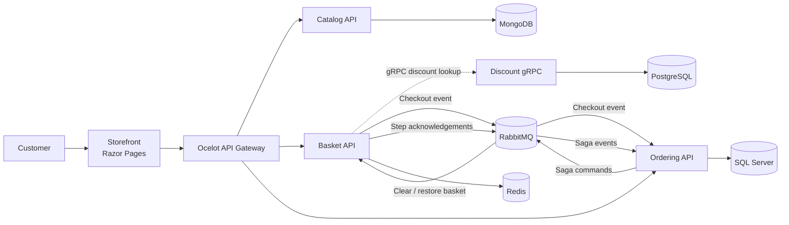
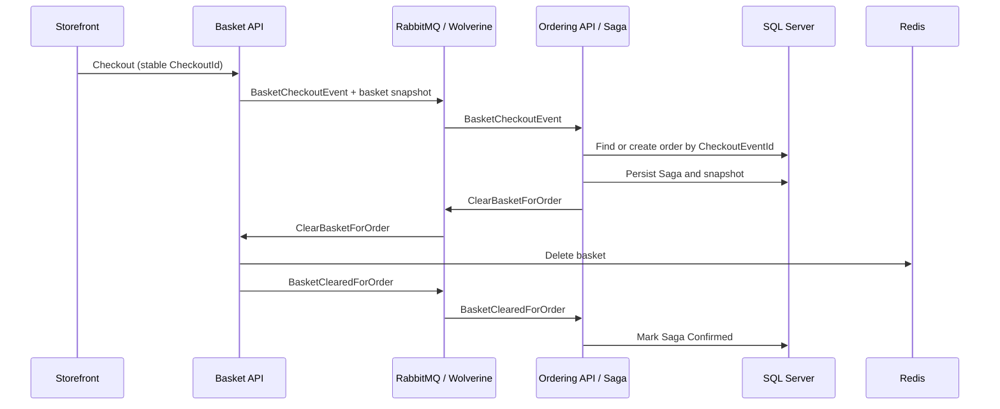

# Aspnet Microservices Store

A sample e-commerce platform built with independently deployable .NET services. It demonstrates service-to-service communication, containerized development, and an orchestrated checkout and cancellation workflow.

> **Project status:** This is a learning and demonstration project. Review the security and operational notes before adapting it for production.


## What this project demonstrates

- Service-oriented e-commerce domains: catalog, basket, discounts, and orders
- Synchronous service calls with HTTP and gRPC
- Asynchronous messaging with RabbitMQ and Wolverine
- Checkout idempotency using a stable event ID and a unique database index
- An orchestrated Saga that can compensate a checkout by restoring the basket
- Retry and circuit-breaker policies with Polly for transient failures
- Docker Compose development environment with databases, message broker, gateway, and web UI
- Centralized logging and health-check dashboards

## Architecture



### Services and infrastructure

| Component | Responsibility | Main technology |
|---|---|---|
| `Catalog.API` | Product catalog and search | ASP.NET Core, MongoDB |
| `Basket.API` | Shopping basket and checkout messages | ASP.NET Core, Redis, Wolverine |
| `Discount.Grpc` | Discount lookup for basket pricing | gRPC, PostgreSQL, Dapper |
| `Discount.API` | Discount HTTP API | ASP.NET Core, PostgreSQL |
| `Ordering.API` | Orders, checkout processing, and cancellation Saga | ASP.NET Core, EF Core, SQL Server, Wolverine |
| `OcelotApiGw` | Routes storefront API requests | Ocelot |
| `Shopping.Aggregator` | Aggregates responses for storefront scenarios | ASP.NET Core, `HttpClientFactory` |
| `AspnetRunBasics` | Storefront UI | ASP.NET Core Razor Pages |
| `WebStatus` | Health-check dashboard | ASP.NET Core Health Checks UI |
| RabbitMQ | Inter-service message broker | RabbitMQ Management |
| Elasticsearch / Kibana | Centralized logs and log exploration | Elastic Stack |

## Checkout and cancellation workflow

Checkout spans Basket, Ordering, RabbitMQ, Redis, and SQL Server. The flow uses an orchestrated Saga so each step and its acknowledgement can be tracked.



### How idempotency works

1. The checkout page creates a stable `CheckoutId` and posts it with the form.
2. Ordering looks for an order with that `CheckoutEventId` before creating one.
3. SQL Server enforces a unique filtered index on `Orders.CheckoutEventId`. This is the final protection when concurrent deliveries pass the initial lookup at the same time.
4. If a concurrent insert wins, the handler clears the EF Core change tracker and reads the winning order. The Saga then uses that order ID instead of creating a duplicate.

### How cancellation compensates a checkout

The order cancellation endpoint sends `CancelOrderSaga` and returns `202 Accepted`. The Saga changes state and sends `RestoreBasketForOrder` with the basket snapshot saved during checkout. Basket recreates the Redis basket and acknowledges the restore. Only after that acknowledgement does Ordering delete the order and mark the Saga as cancelled.

If cancellation arrives before the Saga start message, Ordering schedules another cancellation attempt after one second, up to 15 times. If no Saga appears, the order is left intact and a warning is logged. Legacy orders without a checkout ID cannot be safely compensated and receive `409 Conflict`.

### Concurrency and delivery guarantees

- Checkout messages are grouped by event ID and processed in message partitions.
- Saga state uses EF Core optimistic concurrency through its version field. Wolverine retries a `SagaConcurrencyException` with short cooldowns.
- Durable Inbox and Outbox are enabled for Wolverine message processing and outgoing endpoints.
- The unique checkout index protects against duplicate order creation even if messages are delivered more than once.
- Basket operations are replay-safe for this workflow: clearing a basket more than once is harmless, and restoring the same snapshot overwrites the basket with the same contents.

These mechanisms do not create a single transaction across SQL Server, Redis, and RabbitMQ. Cross-service consistency is achieved through durable messages, Saga state, acknowledgements, and compensation.

## Resilience and retry policies

Retries are scoped to the failure they can safely recover from:

| Location | Policy | Purpose |
|---|---|---|
| Ordering checkout handler | Polly: 3 retries after 200 ms, 400 ms, and 800 ms | Retries transient SQL exceptions, including SQL exceptions wrapped by EF Core. Clears the EF change tracker before retrying. |
| Ordering startup migration | Polly: 5 retries with 2, 4, 8, 16, and 32 second delays | Gives the SQL Server container time to become available during startup. |
| Saga persistence | Wolverine: retries concurrency conflicts after 100 ms, 250 ms, and 500 ms | Re-runs message handling when optimistic concurrency rejects the Saga update. |
| Storefront and Aggregator HTTP clients | Polly retry and circuit breaker | Handles temporary downstream HTTP failures and stops repeated calls while a dependency is unhealthy. |

The checkout Polly policy does not retry unique-key violations. Those are handled by the idempotency path, which reads the order created by the competing request. Wolverine owns the Saga concurrency retry because the conflict may occur during Saga persistence after the handler has returned.

## Quick start

### Prerequisites

- Docker Desktop with Docker Compose
- .NET SDK for local builds and tests

### Start the full stack

Run this from the repository root:

```powershell
docker compose -f src/docker-compose.yml -f src/docker-compose.override.yml up -d --build
```

Check container status and follow the workflow service logs:

```powershell
docker compose -f src/docker-compose.yml -f src/docker-compose.override.yml ps
docker compose -f src/docker-compose.yml -f src/docker-compose.override.yml logs -f ordering.api basket.api
```

Stop the stack:

```powershell
docker compose -f src/docker-compose.yml -f src/docker-compose.override.yml down
```

Compose volumes preserve database and log data after containers stop. `docker compose down -v` also removes those volumes and their data.

## Local endpoints

| Component | URL |
|---|---|
| Storefront | <http://localhost:8006> |
| Catalog Swagger | <http://localhost:8000/swagger> |
| Basket Swagger | <http://localhost:8001/swagger> |
| Discount Swagger | <http://localhost:8002/swagger> |
| Ordering Swagger | <http://localhost:8004/swagger> |
| Ocelot API Gateway | <http://localhost:8010> |
| RabbitMQ Management | <http://localhost:15672> (`guest` / `guest`) |
| Elasticsearch | <http://localhost:9200> |
| Kibana | <http://localhost:5601> |
| Web Status | <http://localhost:8007> |
| pgAdmin | <http://localhost:5050> (`admin@aspnetrun.com` / `admin1234`) |
| Portainer | <http://localhost:9000> |

The order page is available at `/Order` in the storefront. Basket and Ordering health checks are exposed at `/hc` on their respective API ports.

## Run tests

The Ordering concurrency test uses a temporary SQLite database; it does not require Docker or an external SQL Server instance.

```powershell
dotnet test src/Services/Ordering/Ordering.UnitTests/Ordering.UnitTests.csproj
```

Run all tests discovered by the solution:

```powershell
dotnet test src/aspnetrun-microservices.sln
```

The concurrency test races two inserts with the same checkout ID and verifies that the unique index allows only one order to persist.

## Repository layout

```text
src/
├── ApiGateways/
│   ├── OcelotApiGw/                 API routing
│   └── Shopping.Aggregator/         Aggregated API responses
├── BuildingBlocks/
│   ├── EventBus.Messages/           Event and workflow message contracts
│   └── Common.Logging/              Shared logging setup
├── Services/
│   ├── Basket/Basket.API/           Basket API, Redis, workflow handlers
│   ├── Catalog/Catalog.API/         Product catalog and MongoDB
│   ├── Discount/Discount.Grpc/      gRPC discount service
│   └── Ordering/
│       ├── Ordering.API/            API, Wolverine setup, workflow handlers
│       ├── Ordering.Application/    Commands, queries, application logic
│       ├── Ordering.Domain/         Order domain model
│       ├── Ordering.Infrastructure/ EF Core, SQL Server, checkout Saga
│       └── Ordering.UnitTests/      Checkout concurrency tests
└── WebApps/
    ├── AspnetRunBasics/             Razor Pages storefront
    └── WebStatus/                   Health dashboard
```

## Configuration and security notes

Development connection strings, ports, and service dependencies are defined in [`src/docker-compose.override.yml`](src/docker-compose.override.yml). The compose configuration contains sample credentials intended for local development; replace them and move secrets to a secure secret store before deploying anywhere shared or public.

The sample checkout model includes payment fields to demonstrate the request flow. Do not store or log raw card numbers or CVV values in a real payment system. Use a payment provider and tokenization, and keep sensitive payment data out of the order database.

## Contributing

Issues and pull requests that improve the examples, documentation, or reliability are welcome. For a change to checkout behavior, include tests for idempotency, concurrency, or compensation as appropriate.

---

If this repository helps you understand .NET microservices, consider giving it a star.
